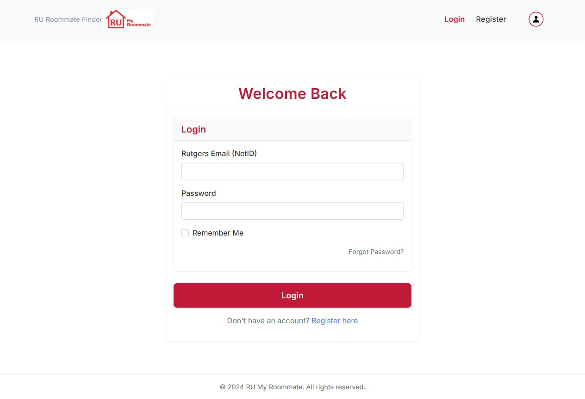
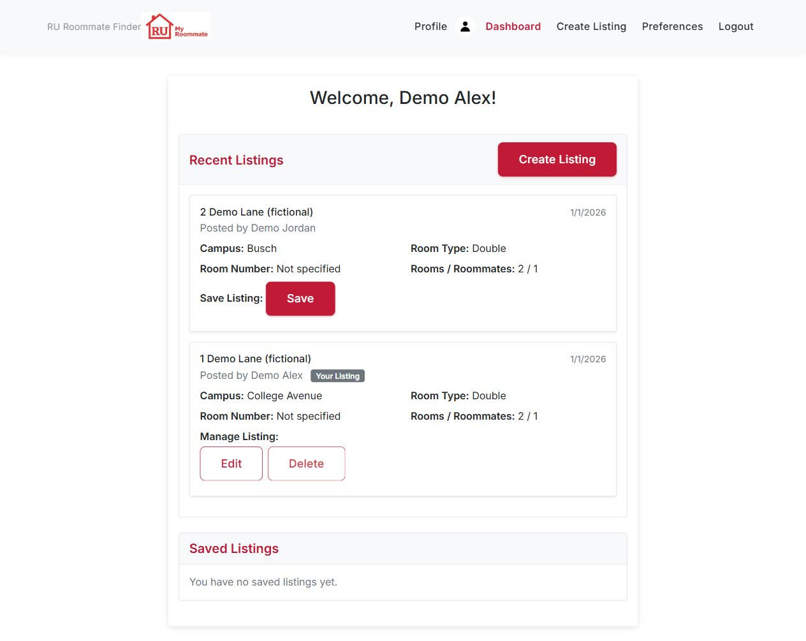
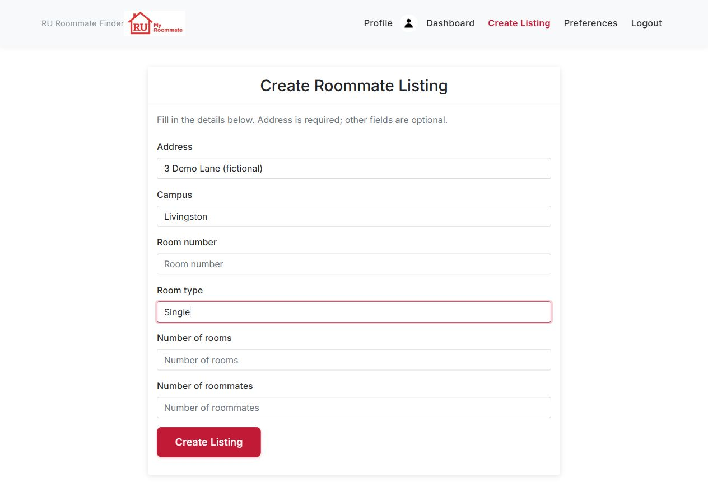
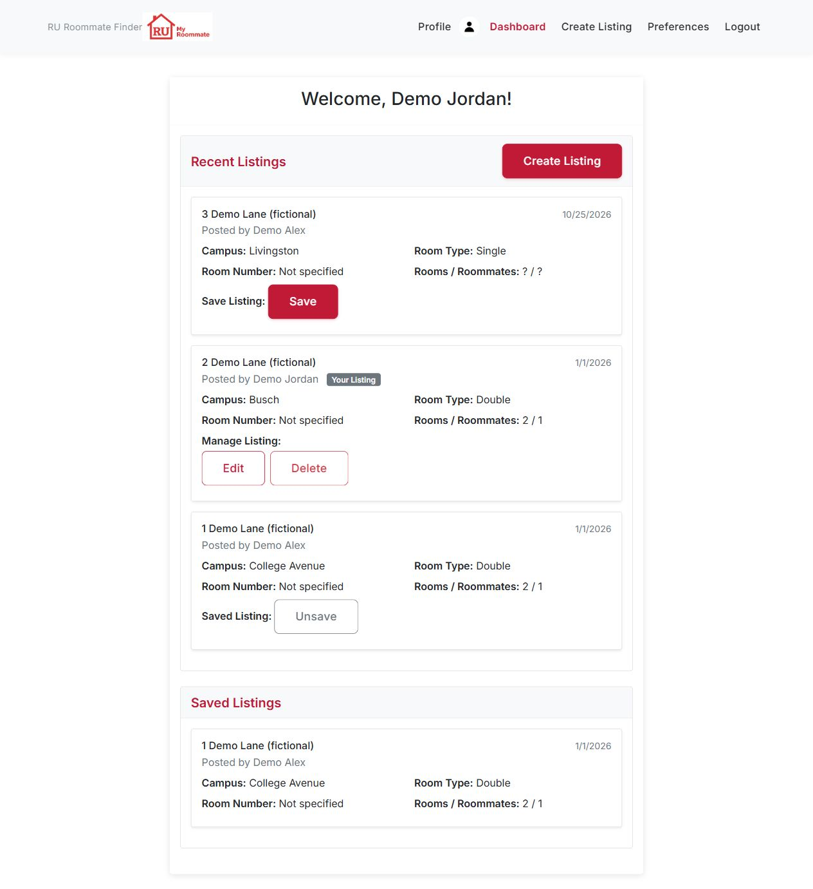

# RU My Roommate

A roommate-listing app for Rutgers students: create a housing listing, browse
other students' listings, and keep a personal saved list. Originally developed
for Software Engineering (14:332:452, Spring 2025), the current MVP focuses on
owner permissions, saved-listing integrity, and tested API behavior.

## MVP scope

**Working in the canonical app:**

- Local email/password registration, login, logout, and session-protected pages.
- Listing creation and browsing; owners can edit and delete their own listings.
- Save/unsave toggles and a saved-listings view, including an empty state.
- Deleting a listing removes its dependent saves through a database cascade.
- Profile, lifestyle-habit, and roommate-preference storage and editing.
- Reproducible fictional demo data and Jest/Supertest API integration tests.

**Outside the current MVP:** automatic roommate matching/ranking, preference-based
listing filtering, Rutgers SSO or verified student identity, messaging, and
password recovery. The UI calls the email field “NetID,” but authentication uses
locally stored bcrypt password hashes; the server accepts general email syntax.
“Remember Me” stores the email locally for the next login; it does not extend the
server session. “Forgot Password?” is a placeholder with no recovery flow.

The app uses Express's in-memory session store. Restarting clears sessions.
The [deployment runbook](docs/deployment.md) covers release preparation,
environment variables, migrations, smoke checks, and recovery. It identifies
unresolved production prerequisites; no completed production deployment is claimed.

## Reviewer quick tour

1. Follow [local setup](#local-setup), then run `npm run demo:seed` and `npm start`.
2. Open [the local login page](http://localhost:3000/login). All demo accounts use
   password `DemoPass1!`; start with `demo1@rutgers.edu` (Alex).
3. Follow the [demo walkthrough](#demo-walkthrough) to compare owner and non-owner
   controls, save/unsave a listing, and verify deletion cleanup.
4. Run [the API tests](#api-tests) against a separate test database.

## Core-flow screenshots

Captured from the canonical app on October 25, 2026 with fictional PR-017 demo
data. These are actual browser captures, not design mockups. The capture session
used port 3001 and an isolated test database; normal local setup defaults to 3000.

### Sign in



### Browse and manage your listing

Alex sees Edit/Delete only on his own listing and an empty Saved Listings section.
The Edit action uses browser prompts for address, campus, and room type; Delete
asks for confirmation.



### Create a listing

Address is required; the other fields are optional. This filled form was submitted
successfully during capture.



### Save and unsave

Jordan sees Alex's saved listing and owns the Busch listing. The additional
Livingston listing was created during the preceding capture step.



## Architecture and documentation

HTML, Bootstrap 5, and browser JavaScript provide the frontend. Node.js and
Express serve pages and JSON APIs; MySQL stores accounts, habits, preferences,
listings, and saves. Listing and health routes live under `src/routes/`;
authentication and profile routes remain in `app.js`. The shared database pool
is in `src/config/db.js`. Jest and Supertest exercise the real app with MySQL.

- [Verified roadmap](docs/roadmap.md)
- [Original scope and acceptance criteria](docs/planning/mvp-tracking-board.md)
- [Detailed API contract](docs/api-contract.md)
- [Deployment runbook and release gates](docs/deployment.md)

## ▶ Runtime Entrypoint (Canonical)

Use `app.js` as the **single canonical runtime entrypoint**.

- Start: `npm start` (runs `node app.js`)
- Dev: `npm run dev` (runs `nodemon app.js`)

### Legacy Code Boundary (Non-MVP Path)

The following paths are legacy from earlier iterations and are **not** part of the current MVP runtime path:

- `server.js` (kept as a compatibility shim; delegates to `app.js`)
- `databaseserver/*`
- `mainpage/*`

These legacy modules are retained for reference/history and should not be used for new feature work unless explicitly migrated.


---

## Local setup

Prerequisites: Node.js and npm (verified with Node 24), MySQL 8.0, and the MySQL
command-line client on PATH. Run commands from the repository root. MySQL must
be running and your database user must be able to create the local database and
apply schema changes. Bootstrap assets load from a CDN, so full styling needs
internet access.

Follow these steps in order for a fresh local database. The schema contains DROP
TABLE statements; do not import it over data you want to keep. Migrations 001–003
are one-time changes, not commands to rerun at every startup.

### 1) Install dependencies

```bash
npm ci
```

### 2) Create local environment file

Copy the example file and update values for your machine. If `.env` already
exists, edit it instead; the copy command deliberately refuses to overwrite it:

```bash
node -e "require('fs').copyFileSync('.env.example', '.env', require('fs').constants.COPYFILE_EXCL)"
```

Edit `.env` with your local MySQL credentials and a long random `SESSION_SECRET`.
Keep `DB_NAME=rumyroommate` for the SQL below. Existing shell environment variables
override `.env`; keep development and test shells separate.

Required environment keys:

- `PORT`
- `DB_HOST`
- `DB_PORT`
- `DB_USER`
- `DB_PASSWORD`
- `DB_NAME`
- `SESSION_SECRET`

### 3) Initialize the database schema

From the repo root:

```bash
mysql -h 127.0.0.1 -P 3306 -u YOUR_DB_USER -p --execute="source database/schema.sql"
```

Replace `YOUR_DB_USER`, host, and port with your local settings; `-p` prompts for
the password. These commands work in PowerShell and Bash. The schema creates/uses
`rumyroommate`; the migration files also explicitly select that database.

### 4) Apply migrations (in order)

Run migrations **in filename order**:

First inspect schema state using the [deployment migration procedure](docs/deployment.md#4-prepare-the-database).
The checked-in base schema already contains migration 001's result: **skip 001
after importing that schema**. For an existing database, apply only missing
migrations; never include the 004 rollback in the forward sequence.

```bash
mysql -h 127.0.0.1 -P 3306 -u YOUR_DB_USER -p --execute="source database/migrations/002_make_listing_preferenceids_nullable.sql"
mysql -h 127.0.0.1 -P 3306 -u YOUR_DB_USER -p --execute="source database/migrations/003_make_savedroommatelistings_saveid_autoincrement.sql"
mysql -h 127.0.0.1 -P 3306 -u YOUR_DB_USER -p --execute="source database/migrations/004_set_saved_postid_on_delete_cascade.sql"
```

Migration order is required because each migration assumes prior schema state.

### 5) Start the app

Canonical runtime is `app.js`:

```bash
npm start
```

Dev mode:

```bash
npm run dev
```

---


## Demo data (PR-017)

After completing schema setup and migrations 001 through 004 above, seed the
local development database configured in `.env`:

```bash
npm run demo:seed
npm start
```

This creates three fictional users with hashed passwords and profile rows, two
listings, and three saves. All three accounts use password `DemoPass1!`:

- `demo1@rutgers.edu` (Alex): owns the College Avenue listing; no initial saves.
- `demo2@rutgers.edu` (Jordan): owns the Busch listing; saves Alex's listing.
- `demo3@rutgers.edu` (Taylor): owns no listing; saves both listings.

These identities are reserved for the demo. Use only a local development database
with fictional data; the credentials are public. The script refuses
`NODE_ENV=production` and requires migration 004's saved-row cascade.
It uses the same `DB_*` settings as the application; existing shell environment
variables take precedence over `.env`.

To restore the dataset after editing, deleting, or adding listings, stop the app
and run:

```bash
npm run demo:reset
npm start
```

Reset deletes and recreates the three reserved accounts, their habits/preferences,
all listings they own, their saves, and notifications involving those accounts or
listings. Other users' saves of demo listings are removed by the database cascade.
Unrelated accounts, listings, saves, and notifications are preserved. Changes are
transactional: a failure rolls back the reset. Plain `demo:seed` refuses to change
existing demo identities; `demo:reset` explicitly opts into replacing their data
and also works before the first seed. Do not run seeds/resets concurrently or while
using the demo. Restarting clears in-memory sessions; log in again afterward.
Numeric IDs and password hashes can change, but the demo content is reproduced.

### Demo walkthrough

1. Log in at `/login` as Alex. Open `/dashboard`, inspect the two listings and
   empty saved state, and edit Alex's listing using the owner controls.
2. Log out and log in as Jordan (or use a separate browser session). Alex's
   listing starts saved; unsave and save it again. Owner controls appear only
   on Jordan's listing. API edit/delete attempts against Alex's listing return `403`.
3. Log in as Taylor to see both saved listings. Log back in as Alex and delete
   Alex's listing. Refresh Jordan's and Taylor's dashboards: Jordan's saved view
   is empty and Taylor retains only the Busch listing.
4. As Alex, create a new listing through `/create-listing`, then log out. Run the
   reset commands above to return to the original dataset.

Automated verification uses the isolated test database described below:

```bash
npm test -- tests/api/demo-data.test.js
```

It exercises demo login, profile/browse, create/edit/delete, non-owner rejection,
save/unsave, cascade cleanup, logout, repeated reset, unrelated-data preservation,
rollback on failure, and the CLI commands. It does not automate browser interactions.

## API tests

The canonical API integration test harness is now **Jest + Supertest**.

### One-command test run

```bash
npm test
```

Additional test commands:

```bash
npm run test:watch  # Run Jest in watch mode
npm run test:smoke  # Run the API smoke-test suite
```

### Test environment setup (safe + isolated)

1. Copy test env template:

```bash
node -e "require('fs').copyFileSync('.env.test.example', '.env.test', require('fs').constants.COPYFILE_EXCL)"
```

2. Update `.env.test` with your local MySQL test credentials.

3. Ensure `DB_NAME` points to an isolated test database (for example: `rumyroommate_test`).

4. Initialize a fresh test database by generating a local SQL copy that changes
   the hard-coded database name in the schema and the three pending migrations:

```bash
node -e "const fs=require('fs'); const files=['database/schema.sql',...['002_make_listing_preferenceids_nullable','003_make_savedroommatelistings_saveid_autoincrement','004_set_saved_postid_on_delete_cascade'].map(n=>'database/migrations/'+n+'.sql')]; fs.writeFileSync('database/schema.test.sql',files.map(p=>fs.readFileSync(p,'utf8').replaceAll('rumyroommate','rumyroommate_test')).join('\n'))"
mysql -h 127.0.0.1 -P 3306 -u YOUR_DB_USER -p --execute="source database/schema.test.sql"
```

Use `DB_NAME=rumyroommate_test` in `.env.test` for these commands. Migration 001
is omitted because the current base schema already lacks those legacy columns.
The generated `database/schema.test.sql` is gitignored. Passing a test database name to the
MySQL client alone is insufficient: the original SQL contains explicit USE
statements. Only import this generated file into a disposable test environment.
Do not run tests while using that same database for an interactive demo; tests
truncate its data after each case.

The harness includes safety guardrails: test startup fails fast unless `DB_NAME` includes `test`, to reduce accidental dev DB mutation.

### Test data lifecycle

- DB pool initializes once before tests.
- Data tables are truncated after each test.
- DB pool closes after the test run.

### Shared helpers for future API suites

Reusable helpers are available in `tests/helpers/auth.helper.js` for:

- creating test users
- logging in test users
- preserving authenticated session cookies via Supertest agent

Current automated coverage includes the PR-017 demo-data suite, the API smoke test, a preferences regression suite, focused PR-012 response-contract checks, the PR-014 auth suite, the PR-015 listings suite, and the PR-016 saved-listings suite. Auth coverage verifies registration success and invalid/duplicate failures, login success and failure, session isolation, and protected-page redirects. The PR-012 checks cover all ten protected API endpoints without a session. The listings suite verifies creation/validation, persisted owner edits, owner deletion, non-owner rejection, and missing/deleted listings, including database state after successful and rejected mutations. These suites reuse the response assertions in `tests/helpers/contract.helper.js`. The saved-listings suite verifies save persistence, user isolation, duplicate/self-save rejection, idempotent unsave and re-save, and deletion cleanup across multiple users. It checks stored rows directly as well as both saved-results endpoints, including preservation of unrelated saves.

Run the focused auth cases together with their shared contract checks:

```bash
npm test -- tests/api/auth.test.js tests/regression/api-contract.regression.test.js
```

Run `npm test` twice consecutively to verify repeatability against the same isolated test database. Auth cases use fixed identities, fresh app/session instances, and the harness's per-test cleanup.

---

## API summary

The API uses JSON and cookie-based sessions. In brief:

- Auth: `POST /api/register` (201), `POST /api/login` (200),
  `GET /api/me` (200), and `POST /api/logout` (200).
- Listings: public `GET /api/listings` (200); authenticated
  `POST /api/listings` (201); owner-only `PATCH` and `DELETE /api/listings/:postid` (200).
- Saves: `POST /api/listings/:postid/save` (201),
  `DELETE /api/listings/:postid/save` (200, idempotent for an existing listing),
  `GET /api/saved-listings`, and `GET /api/saved-listing-ids` (200).
- Profile/preferences: `GET /api/user-data` and `POST /api/update-preferences` (200).
- Database check: `GET /api/health/db` (200).

Protected APIs return 401 without a session; non-owner edits/deletes return 403,
missing listings return 404, duplicate saves return 409, and self-saves return 400.
Create/edit validation failures return 400. Full payloads and error cases are in:

- [API contract](docs/api-contract.md)

All successful API responses use `{ "data": ... }`; errors use `{ "error": "..." }`. Read success payloads from `body.data`, including the listings array. Duplicate registration returns `409`. The bundled frontend is updated for this contract; external clients must migrate their success-payload readers. See the API contract for endpoint payloads, status codes, and migration details.

## ✅ First-Run Verification Checklist

After startup, verify:

1. Server boots without DB initialization errors.
2. `http://localhost:3000` loads the front page.
3. `http://localhost:3000/api/health/db` returns `{ "data": { "tables": [...] } }`.
4. Register a user from `/register` and confirm success response.
5. Log in from `/login` and confirm redirect to `/dashboard`.

If step 3 fails, re-check `.env` values and migration/schema commands.

---

## 🔐 Session/Auth Hardening (PR-011) Notes

### Session cookie behavior by environment

`express-session` cookie settings are now environment-aware:

- **Development (`NODE_ENV` not equal to `production`)**
  - `cookie.secure = false`
  - `cookie.sameSite = "lax"`
- **Production (`NODE_ENV=production`)**
  - `cookie.secure = true` (HTTPS required)
  - `cookie.sameSite = "lax"`

For both environments:

- `cookie.httpOnly = true`
- `cookie.maxAge = 24h`
- `saveUninitialized = false` (avoids setting empty sessions before login)

### Auth handling rules

- **API routes** return `401` JSON (`{ "error": "Not authenticated" }`) when unauthenticated.
- **Page routes** (`/dashboard`, `/create-listing`, `/preferences`) keep redirect behavior to `/login` when unauthenticated.

### Logout/session invalidation behavior

- `/api/logout` now destroys the server session with callback error handling.
- On success, it also clears `connect.sid` so navbar/session state stays correct after logout + refresh.

---

## 🧪 Listing Validation Hardening (PR-010) Manual API Tests

<details>
<summary>Optional Bash/curl checks for listing validation</summary>

Use Bash (or Git Bash on Windows) for these examples. After seeding the demo,
log in as Alex and save the session cookie before running the validation checks.

```bash
BASE=http://localhost:3000/api
OWNER_COOKIE=owner-cookies.txt
curl -i -X POST "$BASE/login" \
  -c "$OWNER_COOKIE" \
  -H "Content-Type: application/json" \
  -d '{"netid":"demo1@rutgers.edu","password":"DemoPass1!"}'
```

For PATCH tests, first create a valid listing, copy the returned `postid`, then set:

```bash
VALID_POSTID=123 # Replace 123 with the postid returned when you create a listing.
```

### Negative tests

```bash
# 1) Create with missing address -> 400
curl -i -X POST "$BASE/listings" \
  -b "$OWNER_COOKIE" \
  -H "Content-Type: application/json" \
  -d '{}'

# 2) Create with blank address -> 400
curl -i -X POST "$BASE/listings" \
  -b "$OWNER_COOKIE" \
  -H "Content-Type: application/json" \
  -d '{"address":"   "}'

# 3) Create with numrooms: -1 -> 400
curl -i -X POST "$BASE/listings" \
  -b "$OWNER_COOKIE" \
  -H "Content-Type: application/json" \
  -d '{"address":"1 College Ave","numrooms":-1}'

# 4) Create with numroommates: 1.5 -> 400
curl -i -X POST "$BASE/listings" \
  -b "$OWNER_COOKIE" \
  -H "Content-Type: application/json" \
  -d '{"address":"1 College Ave","numroommates":1.5}'

# 5) Create with numeric string ("3") -> 400
curl -i -X POST "$BASE/listings" \
  -b "$OWNER_COOKIE" \
  -H "Content-Type: application/json" \
  -d '{"address":"1 College Ave","numrooms":"3"}'

# 7) Patch with empty body -> 400
curl -i -X PATCH "$BASE/listings/$VALID_POSTID" \
  -b "$OWNER_COOKIE" \
  -H "Content-Type: application/json" \
  -d '{}'

# 8) Patch with unknown field -> 400
curl -i -X PATCH "$BASE/listings/$VALID_POSTID" \
  -b "$OWNER_COOKIE" \
  -H "Content-Type: application/json" \
  -d '{"unknownField":"x"}'

# 9) Patch with blank address -> 400
curl -i -X PATCH "$BASE/listings/$VALID_POSTID" \
  -b "$OWNER_COOKIE" \
  -H "Content-Type: application/json" \
  -d '{"address":"   "}'

# 10) Patch with invalid numeric fields -> 400
curl -i -X PATCH "$BASE/listings/$VALID_POSTID" \
  -b "$OWNER_COOKIE" \
  -H "Content-Type: application/json" \
  -d '{"numroommates":-2}'
```

### Normalization test

```bash
# 6) Optional empty strings are accepted and normalized to null
curl -i -X POST "$BASE/listings" \
  -b "$OWNER_COOKIE" \
  -H "Content-Type: application/json" \
  -d '{"address":"1 College Ave","campus":"   ","roomnumber":"","roomtype":"  "}'
```

### Positive tests

```bash
# 11) Valid create still works
curl -i -X POST "$BASE/listings" \
  -b "$OWNER_COOKIE" \
  -H "Content-Type: application/json" \
  -d '{"address":"1 College Ave","campus":"Busch","roomnumber":"101","roomtype":"Double","numrooms":3,"numroommates":2}'

# 12) Valid patch still works
curl -i -X PATCH "$BASE/listings/$VALID_POSTID" \
  -b "$OWNER_COOKIE" \
  -H "Content-Type: application/json" \
  -d '{"campus":"Livingston","numrooms":2}'
```

</details>
